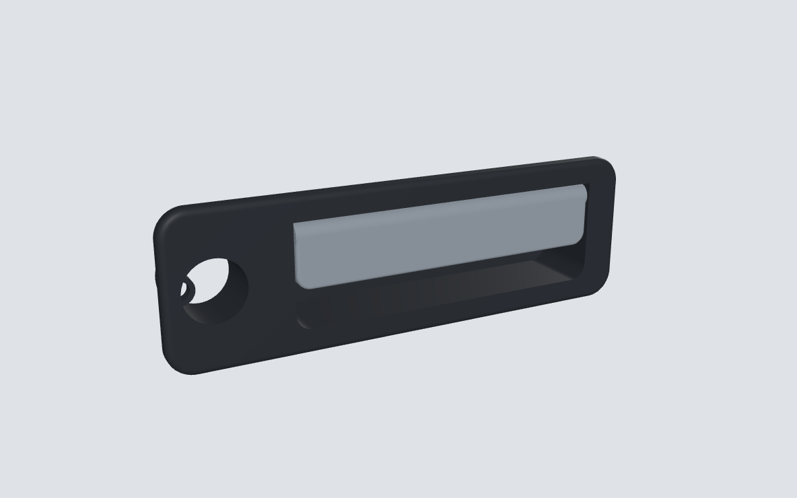
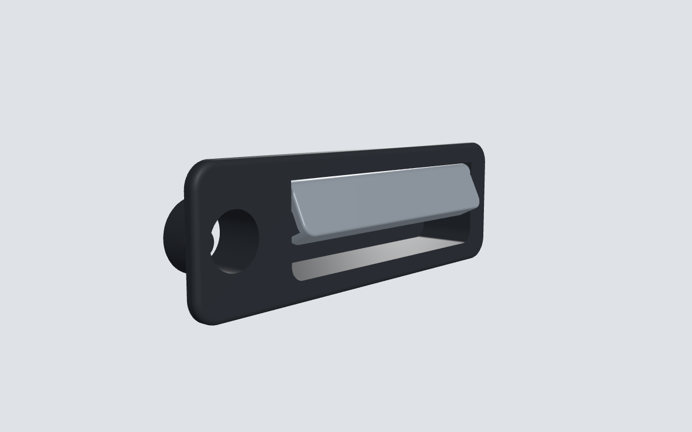
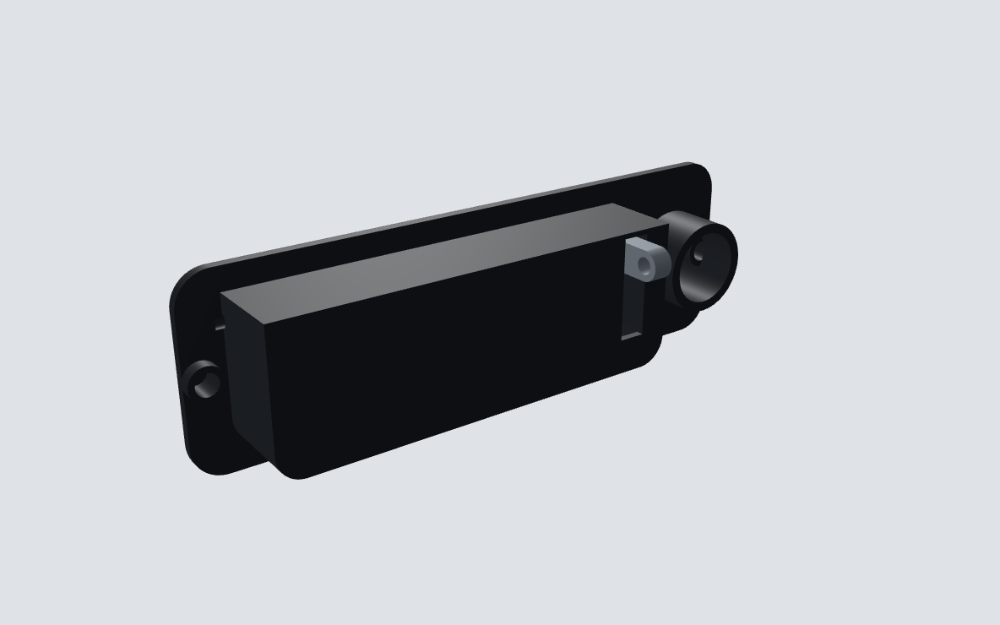

# Наружная ручка двери Toyota Corolla Ceres (AE100/AE101, 1996)

Параметрическая модель наружной ручки двери для печати. **Это черновик:**
готовых чертежей или 3D-моделей этой ручки в открытом доступе нет, поэтому
все размеры оценены по типовым ручкам Toyota того поколения, а не сняты
с оригинала. Форма и механика рабочие, а под конкретную дверь размеры
нужно подогнать по замерам (список ниже). Скрипт перестраивает всё за
минуту.





## Устройство

Ручка типа «лопатка» (flap): пальцы заводятся в щель снизу, лопатка
тянется вверх-наружу и поворачивается на оси у верхнего края. Рычаг на
лопатке уходит внутрь двери и тянет тягу замка вниз.

| Деталь | Что это | Печать |
|---|---|---|
| `*_bezel` | Корпус-накладка: рамка на двери + чашка под пальцы, упоры закрытого положения, бобышки крепления, у передних — гнездо личинки | Лицом вниз на стол |
| `*_flap` | Лопатка с втулкой оси и рычагом на тягу | Лицом вниз, поддержка под рычаг |
| — | Ось: стальной пруток Ø4 мм, длина ≈ 124 мм (по внешним торцам чашки) | Покупная |
| — | Возвратная пружина (кручения, с оригинала) | Покупная или с донора |
| — | 2 × термовставка M5 + болт M5 изнутри двери с широкой шайбой | Покупные |

Ход лопатки — 25°, проверено пересечением тел: до 35° лопатка ни во что
не упирается, а внутрь её не пускают упоры на торцах чашки.

## Файлы

| Вариант | Для какой двери |
|---|---|
| `key_right_*` | Передняя правая с личинкой (у праворульной Ceres — водительская) |
| `key_left_*` | Передняя левая с личинкой |
| `plain_right_*`, `plain_left_*` | Двери без личинки (задние, и передняя пассажирская, если на ней нет замка) |

`step/` — для доработки в CAD (Fusion, FreeCAD, Компас), `stl/` — для слайсера.

Система координат: X вдоль машины, Y наружу из двери (Y=0 — поверхность
обшивки), Z вверх. Миллиметры.

## Что замерить на оригинале

Всё это — параметры в начале `tools/handle.py` (класс `P`):

1. Длина и высота накладки снаружи (`open_len`, `margin_x`, `margin_z`).
2. Размер прямоугольного выреза в обшивке двери, для этого ручку надо
   снять (`open_len + 2·wall`, `open_h + 2·wall`).
3. Расстояние между крепёжными шпильками или болтами и их диаметр.
4. Насколько накладка выступает над дверью (`proud`).
5. Положение оси лопатки и диаметр штифта (`pin_d`).
6. Рычаг тяги: вылет от оси (`arm_reach`), с какого торца он стоит,
   диаметр отверстия под клипсу (`rod_hole_d`).
7. Диаметр личинки замка (`key_hole_d`).

Достаточно штангенциркуля и пары фото: ручку спереди, сбоку и снятую
ручку сзади.

## Материал

Ручка живёт на солнце и на морозе. **ASA** — лучший вариант (не желтеет,
держит ~95 °C), **PETG** — допустимо. **PLA не подходит**: летом на
тёмной двери поплывёт. Стенки 4+ периметра, заполнение 40–60 %: лопатка
и рычаг работают на изгиб каждый раз, когда открывают дверь.

## Пересборка

```sh
pip install cadquery
python3 tools/export_all.py                     # STEP + STL всех вариантов
python3 tools/build_viewer.py viewer.html       # самодостаточный 3D-просмотрщик
```

Рендеры в `renders/` снимаются из этого просмотрщика в headless Chromium:
`tools/render_shots.mjs` (нужны Playwright и `npm install three@0.160.0`
рядом со скриптом, ракурсы — в `renders/shots.json`).
